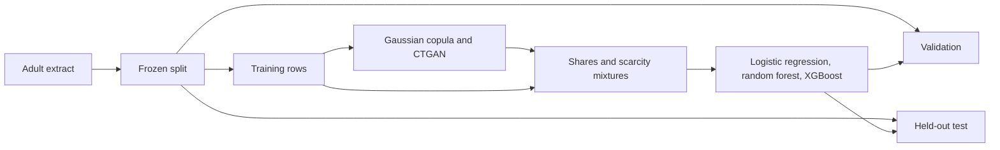
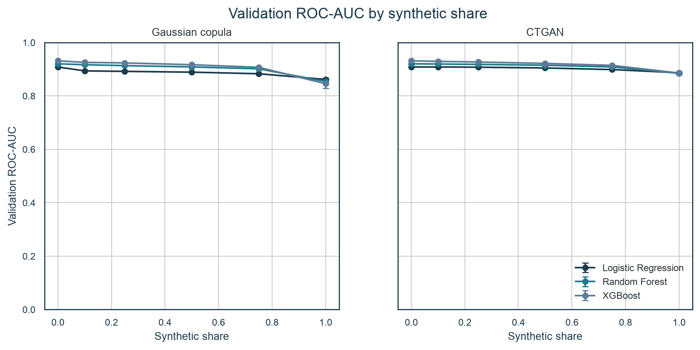
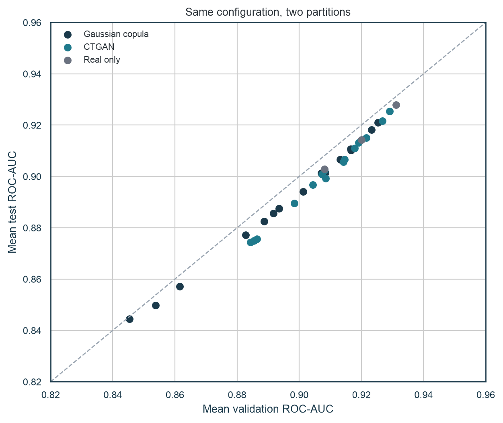

# Can Synthetic Data Improve Machine Learning?

**Author:** Preeti Gorial  
**Project:** Projet Étudiant, Université de Technologie de Troyes (UTT), 2026–2027

Can rows drawn from a Gaussian copula or CTGAN improve income classification when the real Adult Census Income training set is already available, and when only part of it is available?

Adult is a standard mixed-type classification extract. Synthetic rows are easy to add and easy to over-interpret. This project measures that addition on one frozen split, with the analysis rules written before the utility results were read.

## Research questions

1. Does replacing part of a fixed-size training set with synthetic rows change ROC-AUC relative to real rows?
2. Do the Gaussian copula and CTGAN differ under that protocol?
3. When only 25, 50, or 75 percent of the real training rows are available, does adding synthetic rows beyond that budget change ROC-AUC?
4. Does closer distributional fidelity accompany higher synthetic-only ROC-AUC?

## Design

The pooled Adult extract has 48,842 rows. The frozen split, seed 42, has 34,189 training, 7,326 validation, and 7,327 test rows. Source-row overlap across partitions is zero. Generators were fit on real training rows only. Logistic regression, random forest, and XGBoost use the Phase 1 hyperparameters. Five seeds, 42, 123, 2024, 3407, and 777, repeat that one split. They are not five datasets.

Synthetic shares are 0, 10, 25, 50, 75, and 100 percent of the fixed training size. Scarcity then keeps 25, 50, or 75 percent of the real training rows and either adds synthetic rows or replaces real rows. The primary metric is ROC-AUC. Comparisons are paired by seed, with a 95% Student-t interval on five differences. The interval describes these seeds. It is not a confirmatory test.



## Models and generators

| Piece | Choice |
| --- | --- |
| Classifiers | Logistic regression, random forest, XGBoost |
| Generators | SDV Gaussian copula; CTGAN, 80 CPU epochs |
| Decision threshold | 0.5 for precision, recall, F1, and balanced accuracy |
| Selection | Validation only. The test set was scored after the plan was frozen |

## Findings

The numbers below are the saved results. The scientific discussion is in the final report.

Phase 1 validation ROC-AUC, one split: logistic regression 0.9081, random forest 0.9197, XGBoost 0.9313.

On the held-out test set, all 30 main ROC-AUC intervals lie below the matched real-only run. Scarcity augmentation has 16 lower and 2 inconclusive. Replacement has 17 lower and 1 inconclusive. None is higher. For shares below 100 percent, the mean paired test difference is about −0.008 for CTGAN and about −0.015 for the Gaussian copula. The copula matches category frequencies more closely and is the weaker training set.





`results/frozen/validation_freeze.json` still records the moment before any test metric was computed. `results/frozen/post_evaluation_status.json` records the later completed evaluation of 390 test runs. Rebuilding the report does not rescore that partition.

## Install and inspect

Python 3.12 and [uv](https://docs.astral.sh/uv/) are required. From this directory:

```bash
uv sync
uv run python scripts/run_project.py
```

The same entry points are `./run.sh` on macOS or Linux and `.\run.ps1` on Windows PowerShell. `run.ps1` has not been executed on Windows in this release check.

| Command | What it does |
| --- | --- |
| `summary` | Prints dataset, experiment, and result counts from the saved tables. This is the default. |
| `figures` | Redraws the summary figures from those tables. It does not fit a model. |
| `report` | Rebuilds the PDF, DOCX, and Markdown from the saved test metrics. |
| `test` | Runs the fast automated suite. The integration test, which fits a toy generator, stays excluded. |
| `reproduce` | Prints the full pipeline and does not run it. `--execute` runs the validation study only and refuses a held-out rescore. That path is expensive. |

`summary` and `figures` do not retrain CTGAN and do not rerun the held-out test.

## Repository

```text
configs/          experiment, generator, and reporting settings
data/             processed split, raw extract, cached synthetic rows
docs/             analysis plan, inventory, requirements audit
models/           saved Phase 1 classifiers
notebooks/        read-only reviews of the saved tables
reports/          final academic report (PDF, DOCX, editable Markdown)
results/          metrics, figures, freeze, provenance, held-out evaluation
scripts/          study runner and scripts/run_project.py
src/              data, models, generators, experiments, analysis, reporting
tests/            fast suite
```

The superseded Phase 1 and interim reports are intentionally removed from the submission; all baseline metrics, models, and historical hashes remain in the project.

## Reproducibility

The [release checklist](docs/RELEASE_CHECKLIST.md) describes the automated checks, preserved evidence, and intentionally excluded private files. GitHub Actions runs the fast test suite and cached-results summary on pull requests and pushes to `main`; it does not retrain CTGAN or rescore the held-out test.

`uv.lock` pins the environment. Completed generator and classifier files are reused only when the stored cache contract matches. The commands, cache rules, and the reason the original freeze file still says the test metrics were uncomputed are in `REPRODUCIBILITY.md`. Column definitions are in `DATA_DICTIONARY.md`.

## Limitations

One dataset, five seeds, and an 80-epoch CTGAN budget bound every claim. The validation partition was used both for Phase 1 model selection and for the pre-written scarcity-share rule. Duplicate checks are not a privacy guarantee. These results are not a reason to retune epochs or shares on the test set.

The proposal left the dataset open and listed extra scarcity budgets. The 22 October instructions fix Adult income and the 25, 50, and 75 percent budgets, and the experiment follows those instructions. The ten proposal studies are reviewed in the final report. Placeholder DOI text from the proposal was not copied. `docs/source_documents/` is gitignored so the private files are not published.

## References and credit

Preeti Gorial, UTT. The Adult extract is Becker and Kohavi (1996), https://doi.org/10.24432/C5XW20. The ten studies from the approved proposal, with verified publication details, are listed in `reports/final/Preeti_Gorial_Synthetic_Data_Research_Report.pdf`.

The final report is [reports/final/Preeti_Gorial_Synthetic_Data_Research_Report.pdf](reports/final/Preeti_Gorial_Synthetic_Data_Research_Report.pdf).
