:::cover
# Can Synthetic Data Improve Machine Learning?
## Final research report
Preeti Gorial
Projet Étudiant
Université de Technologie de Troyes (UTT)
Academic year 2026–2027
Held-out evaluation timestamp: 2026-11-17T14:35:55+00:00
The test metrics were read from results/final_evaluation/test_run_metrics.csv.
:::

# Abstract

This report asks whether synthetic rows improve income classification on the UCI Adult Census Income table. A Gaussian copula and CTGAN were fit on the frozen training partition. Three classifiers were trained at synthetic shares of 0, 10, 25, 50, 75, and 100 percent, and again when only 25, 50, or 75 percent of the real training rows were available. On the validation partition, 0 ROC-AUC intervals lay entirely above zero, 29 lay entirely below zero, and 1 covered zero. On the held-out test partition, 0 ROC-AUC intervals lay entirely above zero, 30 lay entirely below zero, and 0 covered zero. Five seeds are repeated draws on one split. They are not five datasets. The ten studies named in the approved proposal were checked against publisher or repository records. None of them is this Adult protocol.

Keywords: synthetic data; Gaussian copula; CTGAN; Adult Census Income; held-out evaluation.

# Contents

Page numbers in this list are the pages of this PDF. The Word file also contains a table-of-contents field.

| Section | Page |
| --- | --- |
| Abstract | 2 |
| 1. Introduction | 3 |
| 2. Literature review | 3 |
| 3. Research questions and hypotheses | 4 |
| 4. Dataset | 4 |
| 5. Protocol | 5 |
| 6. Baseline models | 5 |
| 7. Generators | 6 |
| 8. Experimental design | 7 |
| 9. Validation results | 7 |
| 10. Synthetic-data quality | 8 |
| 11. Scarcity on the validation partition | 12 |
| 12. Held-out test evaluation | 13 |
| 13. Validation compared with the test set | 17 |
| 14. Discussion | 18 |
| 15. Limitations | 18 |
| 16. Conclusion | 19 |
| References | 19 |
| Appendix A. Reproduction | 20 |

# List of figures

| Figure | Page |
| --- | --- |
| Figure 1. Target-class distribution in the pooled Adult data. | 5 |
| Figure 2. Validation ROC curves of the frozen Phase 1 models. | 6 |
| Figure 3. Validation ROC-AUC by synthetic share. | 7 |
| Figure 4. Mean validation ROC-AUC of the Gaussian copula and CTGAN. | 8 |
| Figure 5. Numerical distributions for the real training partition and seed 42. | 9 |
| Figure 6. Mean categorical total variation from the real training distribution. | 10 |
| Figure 7. Spearman correlations among numerical features. | 10 |
| Figure 8. Share of rows with income above 50,000 dollars. | 11 |
| Figure 9. Categorical fidelity and synthetic-only validation ROC-AUC. | 12 |
| Figure 10. Validation ROC-AUC under real-data budgets. | 13 |
| Figure 11. Test ROC-AUC by synthetic share. | 14 |
| Figure 12. Mean validation ROC-AUC against mean test ROC-AUC. | 15 |
| Figure 13. Paired test ROC-AUC differences from the matched-seed real-only run. | 16 |
| Figure 14. Test ROC-AUC under real-data budgets. | 17 |

# List of tables

| Table | Page |
| --- | --- |
| Table 1. Pooled income class. | 4 |
| Table 2. Frozen Phase 1 validation metrics. | 5 |
| Table 3. Mean fidelity across five generator seeds. | 8 |
| Table 4. Mean test ROC-AUC in the main experiment. | 13 |
| Table 5. Paired test ROC-AUC differences in the main experiment. | 15 |
| Table 6. Paired test ROC-AUC differences for scarcity augmentation. | 16 |
| Table 7. Paired test ROC-AUC differences for fixed-size replacement. | 17 |
| Table 8. Validation and test interval readings for ROC-AUC. | 17 |

# 1. Introduction

The practical question is whether rows drawn from a generator trained on a census table can improve a classifier that predicts whether income exceeds 50,000 dollars. A positive answer would matter when real rows are scarce or costly. A negative answer matters too, because synthetic rows can look plausible and still move the decision boundary in the wrong direction.

The study uses one public extract, two required generators, and three classifiers whose hyperparameters were frozen before the synthetic experiments. The validation partition was used to describe the mixtures and to apply a pre-written rule for the scarcity share. The held-out test partition was scored only after that plan was frozen. Test scores were not used to choose an epoch budget, a share, a generator, or a classifier.

# 2. Literature review

The approved proposal names ten studies. Each bibliographic record below was checked against the publisher, proceedings, or arXiv page. Placeholder links in the proposal were not copied. Where a record has no DOI, none is invented. Becker and Kohavi (1996) are cited separately because they document the Adult extract required by the later experimental instructions. They are not one of the ten.

Manousakas and Aydöre (2023) compared synthetic tabular data for sharing, augmentation, class balancing, and summarisation. They report marginal gains for balancing on some datasets and conclude that the evidence does not support a general claim that synthetic tabular data improves machine-learning training. Their generators and datasets are not this protocol.

Xu, Skoularidou, Cuesta-Infante, and Veeramachaneni (2019) introduce CTGAN for mixed continuous and categorical columns. On their benchmark, CTGAN outperformed the Bayesian-network baselines on most of the real datasets they studied. That result is about generation quality under their own epoch budget and utility metric. It is not an estimate of the shares used here.

Fonseca and Bacao (2023) review 70 generation algorithms across six machine-learning problem types and treat quality metrics as part of that map. Hernandez, Epelde, Alberdi, Cilla, and Rankin (2022) review 34 papers on synthetic tabular health records, with emphasis on GANs and privacy, and conclude that no single method or metric covers that setting. Jordon et al. (2022) survey motivations and limits. They state that synthetic data is not automatically private and is not a substitute for evaluating a final tool on real data.

Pereira et al. (2024) compare differentially private marginal and GAN generators on utility and fairness. In their pipelines, marginal generators surpassed the GAN generators they tested, and some matched real-data utility. Decruyenaere et al. (2024) show that treating synthetic rows as if they had been observed can inflate false-positive rates in statistical inference, even when estimates are unbiased. Kurakova and Homayouni (2025) propose a medical evaluation framework covering quality, privacy, usability, and computation, and show that duplicate amplification and out-of-range values can be missed by statistical similarity alone. Adams et al. (2025) compare fidelity, utility, and privacy on three patient datasets. Achterberg, Haas, van Dijk, and Spruit (2025) show that a task-specific generator can improve prediction without maximising resemblance to the source table.

| Proposal study | What it contributes | Boundary for this experiment |
| --- | --- | --- |
| Manousakas and Aydöre (2023) | Augmentation is not generally useful | Different generators and datasets |
| Xu et al. (2019) | CTGAN method | Different benchmark and epoch budget |
| Fonseca and Bacao (2023) | Field map and quality metrics | Review, not this grid |
| Hernandez et al. (2022) | Health-record synthesis review | Different domain |
| Pereira et al. (2024) | Private synthesis, utility, fairness | Differential privacy is not used here |
| Decruyenaere et al. (2024) | Inferential utility is a separate question | This study scores prediction |
| Kurakova and Homayouni (2025) | Multidimensional medical evaluation | Smaller diagnostic set here |
| Achterberg et al. (2025) | Utility need not follow fidelity | Their generator was not fit |
| Adams et al. (2025) | Fidelity, utility, and privacy can trade off | Patient data and privacy attacks |
| Jordon et al. (2022) | Synthetic data is not automatically private | No privacy guarantee is claimed |

The proposal left the dataset open and listed scarcity budgets of 100, 50, 25, and 10 percent. The 22 October instructions fix the dataset as Adult income and replace those budgets with 25, 50, and 75 percent. The experiment follows the later instructions. The narrower gap is then the one in the frozen analysis plan: on this split, do these two generators and these three classifiers change ROC-AUC across the specified shares and budgets, and do the fidelity checks move with that utility? The studies above do not answer that question.

# 3. Research questions and hypotheses

The questions and the decision rules were written before the utility results were interpreted.

RQ1. Does the synthetic share of a fixed-size training set change ROC-AUC relative to real training rows alone?

RQ2. Do the Gaussian copula and CTGAN differ in that comparison?

RQ3. When only 25, 50, or 75 percent of the real training rows are available, does augmentation beyond that budget change ROC-AUC relative to a model trained on the budget alone?

RQ4. Does closer distributional fidelity accompany higher synthetic-only ROC-AUC?

The primary metric is ROC-AUC. For a paired difference across five seeds, the report gives the mean, the sample standard deviation, and a 95 percent Student-t interval with four degrees of freedom. An interval entirely above zero is higher on these seeds. An interval entirely below zero is lower. An interval covering zero is inconclusive. A paired t statistic is descriptive only. A zero sample standard deviation is reported as a point.

The directional statement for RQ1, written before the results, was that at least one share in {10, 25, 50, 75} percent would have a paired ROC-AUC interval entirely above zero. A 100 percent run is synthetic-only training and is not called augmentation. RQ3 uses the same interval rule for augmentation minus the budget model. RQ4 is descriptive.

# 4. Dataset

The table is the UCI Adult Census Income extract (Becker & Kohavi, 1996). The pooled file has 48,842 rows, fourteen predictors, and a binary income target. The frozen split places 34,189 rows in training, 7,326 in validation, and 7,327 in test. Source-row overlap is zero. The pooled table contains 52 extra exact duplicate rows and 26 cross-partition duplicate groups covering 54 rows. 5 feature groups have conflicting labels. These records were kept. `fnlwgt` is a predictor, not a sample weight.

Table 1. Pooled income class.

| Income | Rows | Share |
| --- | --- | --- |
| <=50K | 37,155 | 76.07% |
| >50K | 11,687 | 23.93% |

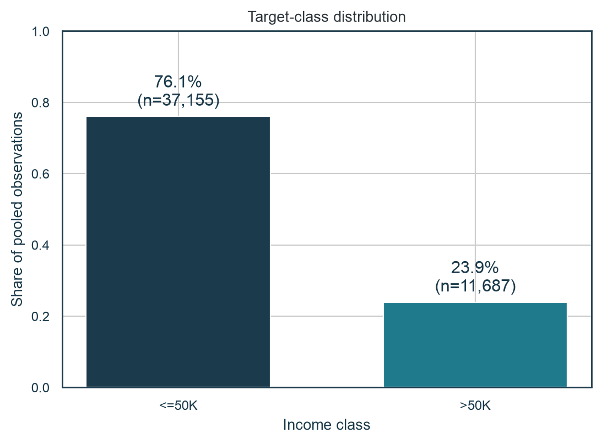

# 5. Protocol

Preprocessing is the Phase 1 pipeline and is fit on the training rows of that run only. Numerical medians and the categorical level Missing are not learned from validation or test rows. Logistic regression standardizes numerical columns. The tree models do not. The decision threshold for F1, precision, recall, and balanced accuracy is 0.5. ROC-AUC uses the predicted probability of income above 50,000 dollars.

The main experiment keeps the training size at N = 34,189. The synthetic count is Python's round of share times N, and the real count is N minus that number. Real and synthetic rows are stratified samples without replacement. The 0 percent condition is one shared real-only baseline. The 100 percent condition contains no real training rows.

Scarcity budgets are 25, 50, and 75 percent of the frozen training partition. Augmentation keeps every real budget row and adds synthetic rows. Replacement holds the training size at the budget. The two are not pooled. The augmentation share was selected on the validation partition by the pre-written rule and is 10 percent for both generators. The test set was not used to make that choice.

# 6. Baseline models

Phase 1 selected logistic regression, random forest, and XGBoost by validation ROC-AUC. Those hyperparameters stay fixed. Each repetition changes only `random_state`. Table 2 repeats the saved one-split validation scores. They are not test scores, and they are not the five-seed means. The five-seed real-only runs reshuffle the same training rows.

Table 2. Frozen Phase 1 validation metrics.

| Model | ROC-AUC | F1 | Precision | Recall | Balanced accuracy |
| --- | --- | --- | --- | --- | --- |
| Logistic Regression | 0.9081 | 0.6562 | 0.7449 | 0.5864 | 0.7616 |
| Random Forest | 0.9197 | 0.6836 | 0.7982 | 0.5978 | 0.7751 |
| XGBoost | 0.9313 | 0.7224 | 0.8046 | 0.6554 | 0.8027 |

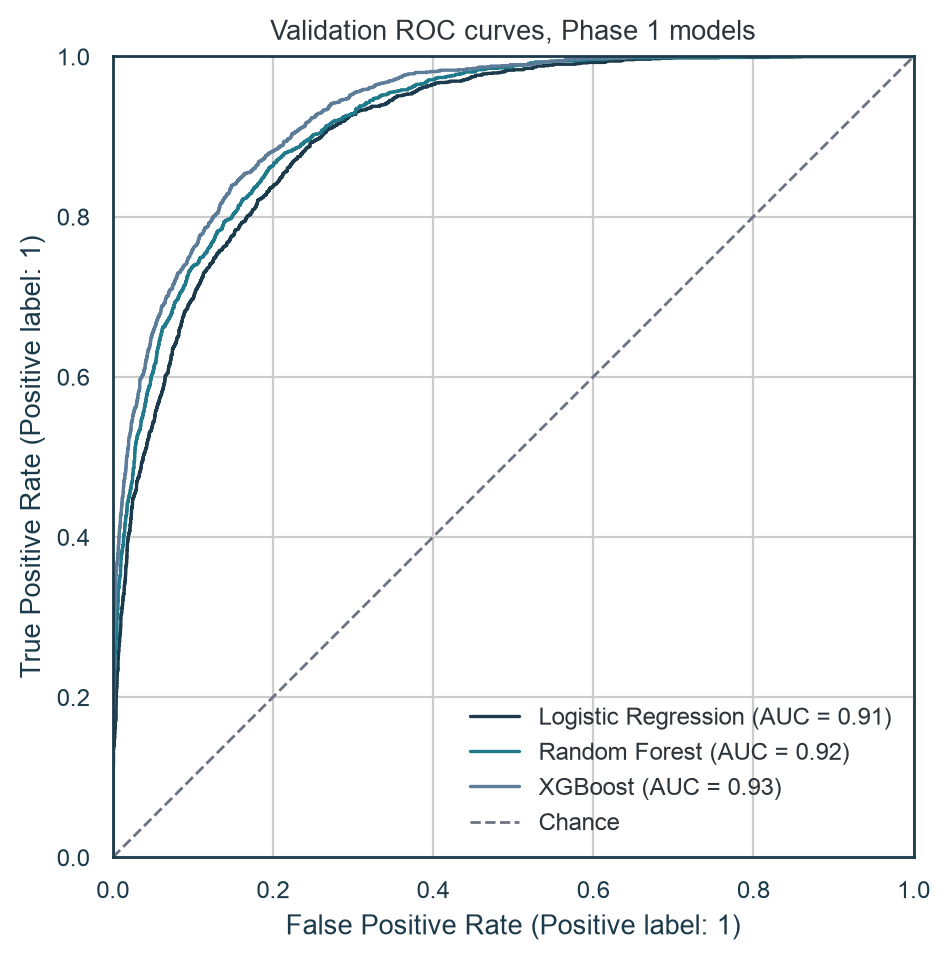

# 7. Generators

Both generators are fit on real training rows only, including the income target. The Gaussian copula uses beta marginals, minimum and maximum enforcement, and rounding. Beta marginals are the recorded SDV default. They are not a claim that the Adult features follow a beta distribution. The dependence model is a Gaussian copula.

CTGAN uses the library architecture: embedding dimension 128, generator and discriminator widths (256, 256), learning rates 0.0002, batch size 500, and pac size 10. Training uses 80 epochs on CPU. The library default is 300 epochs. A two-epoch benchmark on the Apple GPU took 18.9 seconds, but an 80-epoch GPU fit stalled before any classifier was trained. One CPU epoch on the full training partition took about 13 seconds. The epoch budget was written down from that timing check before any full-data utility metric was used to choose it. The shorter budget can leave CTGAN under-trained.

Invalid target labels are counted. Up to three extra sampling rounds may be used. Rows are not duplicated to fill a shortfall. Exact matches to training rows are a memorization check, not a privacy guarantee.

# 8. Experimental design

The validation stage has 165 main runs and 225 scarcity runs, 390 in total. The held-out stage repeats that matrix on the same test partition: real-only; shares of 10, 25, 50, 75, and 100 percent; both generators; three classifiers; five seeds; and the frozen 10 percent scarcity augmentation and replacement runs at three budgets.

Seeds are 42, 123, 2024, 3407, and 777. A comparison uses the same seed for the synthetic run and the real-only run. The sample standard deviation is taken across those five seeds. With four degrees of freedom, a small difference often has an interval that covers zero or that excludes zero by a margin too small to matter for a classifier.

# 9. Validation results

The five-seed real-only validation means are Logistic Regression 0.9081 (SD 0.0000); Random Forest 0.9200 (SD 0.0002); XGBoost 0.9312 (SD 0.0003). Logistic Regression has a sample standard deviation of zero across these seeds.

For main-experiment validation ROC-AUC, 0 ROC-AUC intervals lay entirely above zero, 29 lay entirely below zero, and 1 covered zero. The one inconclusive contrast is the interval that covers zero. The higher count is zero. Shares below 100 percent and the six synthetic-only contrasts are included in that sentence. Raising the synthetic share lowers validation ROC-AUC for both generators. CTGAN declines less than the Gaussian copula.

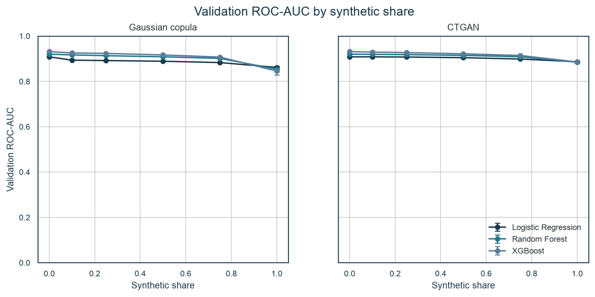

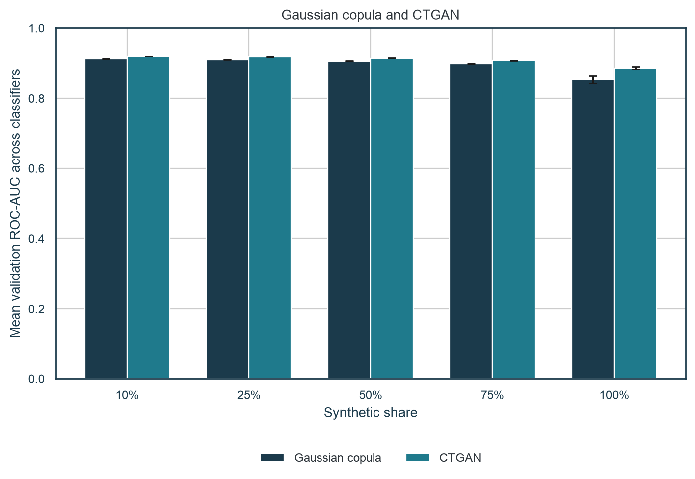

Secondary validation metrics do not reverse the ROC-AUC pattern into a practical gain. Their paired files are in `results/statistical_tests/paired_differences.csv`. On the validation partition, the paired secondary-metric readings are: f1 22 lower, 8 inconclusive, 0 higher; precision 7 lower, 18 inconclusive, 5 higher; recall 19 lower, 11 inconclusive, 0 higher; balanced_accuracy 22 lower, 8 inconclusive, 0 higher.

# 10. Synthetic-data quality

Quality is computed against the real training partition. The test partition is not used. Table 3 gives the mean of each generator across its five seeds.

Table 3. Mean fidelity across five generator seeds.

| Generator | Mean KS | Mean TV | Synthetic positive rate | Exact train match | Near-duplicate rate |
| --- | --- | --- | --- | --- | --- |
| CTGAN | 0.190 | 0.093 | 0.227 | 0.0000 | 0.013 |
| Gaussian copula | 0.307 | 0.005 | 0.240 | 0.0000 | 0.000 |

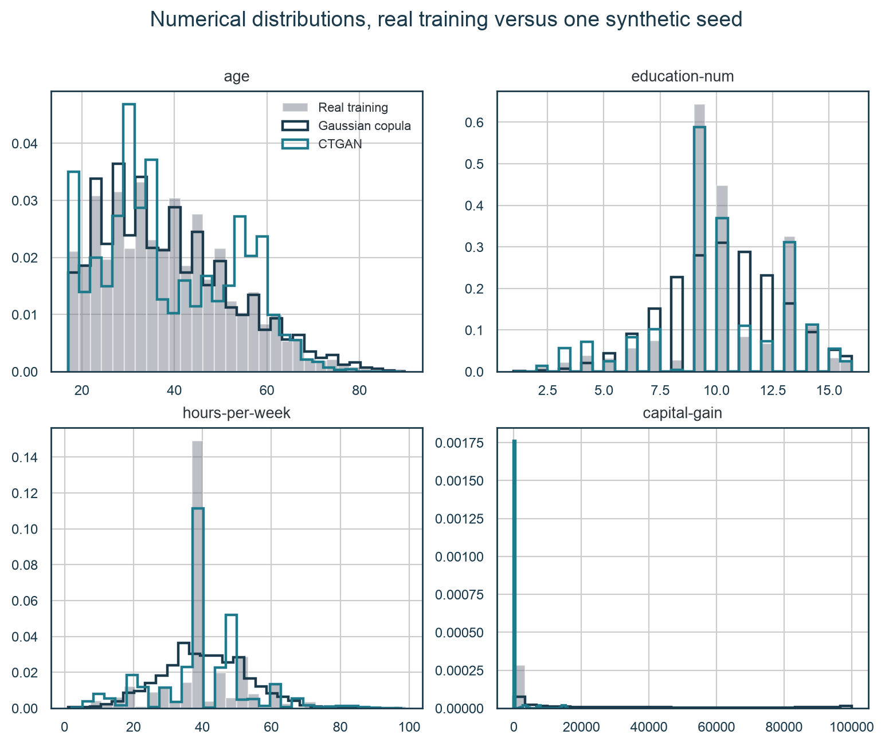

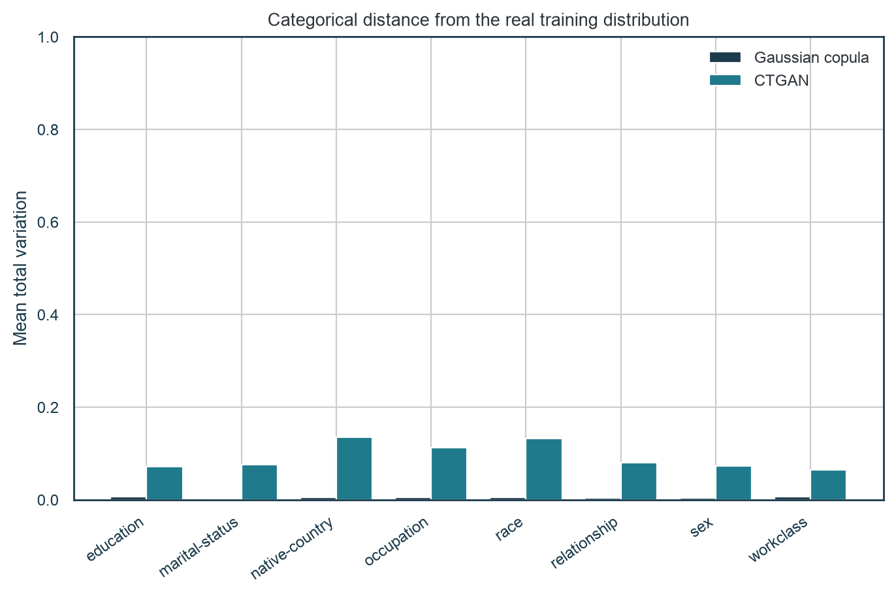

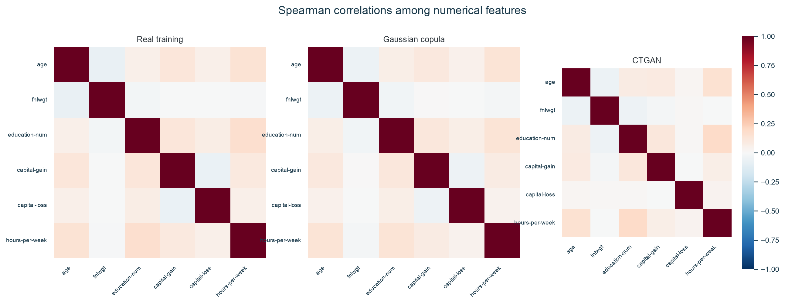

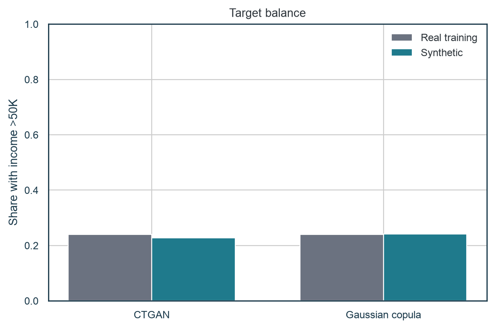

Across the 10 generator-seed points, the Spearman correlation between mean categorical total variation and synthetic-only validation ROC-AUC is 0.758. The descriptive two-sided p-value is 0.011. The Gaussian copula is closer on categories and weaker as a synthetic-only training set. CTGAN is closer on the Kolmogorov-Smirnov distance and has the higher synthetic-only ROC-AUC. Closer category frequencies do not, in this run, mean a more useful training set. Exact training matches are absent. That check is not a privacy guarantee.

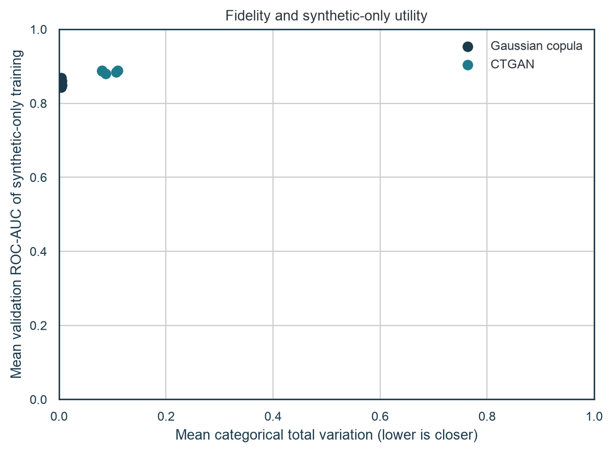

# 11. Scarcity on the validation partition

The pre-written rule selects a 10 percent synthetic share for both generators. Augmentation keeps the real budget and adds rows. Replacement holds the size fixed.

For validation augmentation ROC-AUC, 1 ROC-AUC intervals lay entirely above zero, 15 lay entirely below zero, and 2 covered zero. The higher CTGAN contrast for Logistic Regression has mean difference 0.000254. A ROC-AUC change of this size is not a meaningful practical gain.

For validation replacement ROC-AUC, 0 ROC-AUC intervals lay entirely above zero, 16 lay entirely below zero, and 2 covered zero.

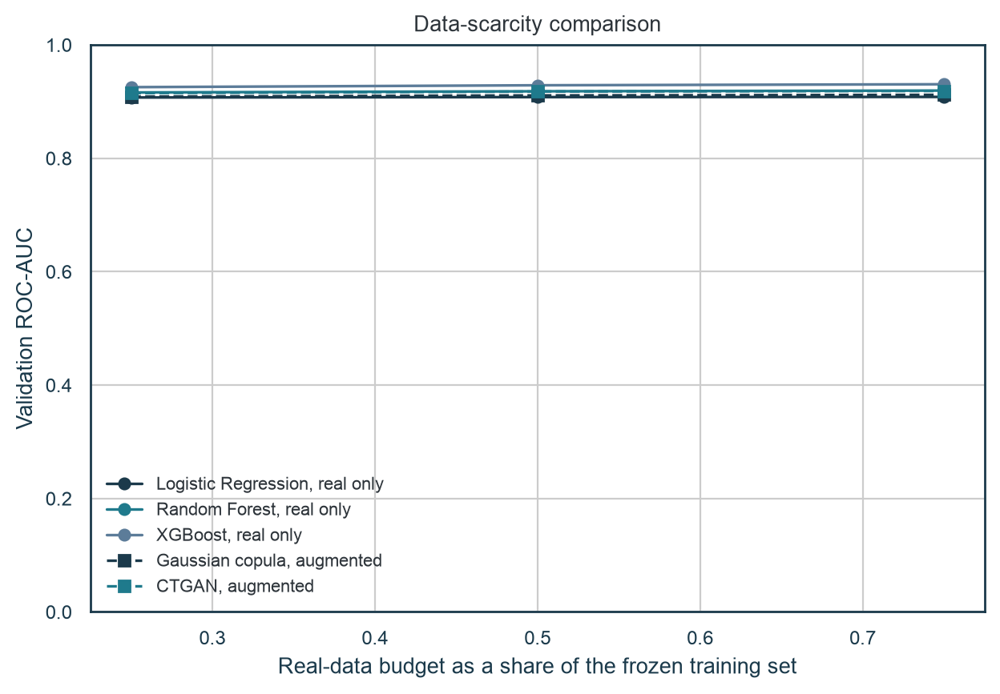

# 12. Held-out test evaluation

The saved test file contains 390 completed runs, all labelled with the test partition. The authorization record names the held-out test and matches the freeze-file hash. Its reviewer field is the text saved when the file was created at the user's request on 17 November 2026. No configuration was changed after these scores were known.

The five-seed real-only test means are Logistic Regression 0.9029 (SD 0.0000); Random Forest 0.9143 (SD 0.0001); XGBoost 0.9278 (SD 0.0002).

Table 4. Mean test ROC-AUC in the main experiment.

| Generator | Share | Model | Mean ROC-AUC (SD) |
| --- | --- | --- | --- |
| CTGAN | 10% | Logistic Regression | 0.9024 (0.0003) |
| CTGAN | 10% | Random Forest | 0.9132 (0.0001) |
| CTGAN | 10% | XGBoost | 0.9254 (0.0011) |
| CTGAN | 25% | Logistic Regression | 0.9009 (0.0003) |
| CTGAN | 25% | Random Forest | 0.9110 (0.0005) |
| CTGAN | 25% | XGBoost | 0.9217 (0.0004) |
| CTGAN | 50% | Logistic Regression | 0.8967 (0.0007) |
| CTGAN | 50% | Random Forest | 0.9067 (0.0004) |
| CTGAN | 50% | XGBoost | 0.9150 (0.0009) |
| CTGAN | 75% | Logistic Regression | 0.8895 (0.0009) |
| CTGAN | 75% | Random Forest | 0.8992 (0.0011) |
| CTGAN | 75% | XGBoost | 0.9056 (0.0013) |
| CTGAN | 100% | Logistic Regression | 0.8756 (0.0036) |
| CTGAN | 100% | Random Forest | 0.8743 (0.0041) |
| CTGAN | 100% | XGBoost | 0.8750 (0.0038) |
| Gaussian copula | 10% | Logistic Regression | 0.8875 (0.0002) |
| Gaussian copula | 10% | Random Forest | 0.9103 (0.0002) |
| Gaussian copula | 10% | XGBoost | 0.9210 (0.0004) |
| Gaussian copula | 25% | Logistic Regression | 0.8856 (0.0004) |
| Gaussian copula | 25% | Random Forest | 0.9067 (0.0003) |
| Gaussian copula | 25% | XGBoost | 0.9181 (0.0009) |
| Gaussian copula | 50% | Logistic Regression | 0.8825 (0.0005) |
| Gaussian copula | 50% | Random Forest | 0.9015 (0.0009) |
| Gaussian copula | 50% | XGBoost | 0.9107 (0.0011) |
| Gaussian copula | 75% | Logistic Regression | 0.8772 (0.0011) |
| Gaussian copula | 75% | Random Forest | 0.8940 (0.0014) |
| Gaussian copula | 75% | XGBoost | 0.9013 (0.0014) |
| Gaussian copula | 100% | Logistic Regression | 0.8571 (0.0044) |
| Gaussian copula | 100% | Random Forest | 0.8497 (0.0097) |
| Gaussian copula | 100% | XGBoost | 0.8445 (0.0120) |
| Real only | 0% | Logistic Regression | 0.9029 (0.0000) |
| Real only | 0% | Random Forest | 0.9143 (0.0001) |
| Real only | 0% | XGBoost | 0.9278 (0.0002) |

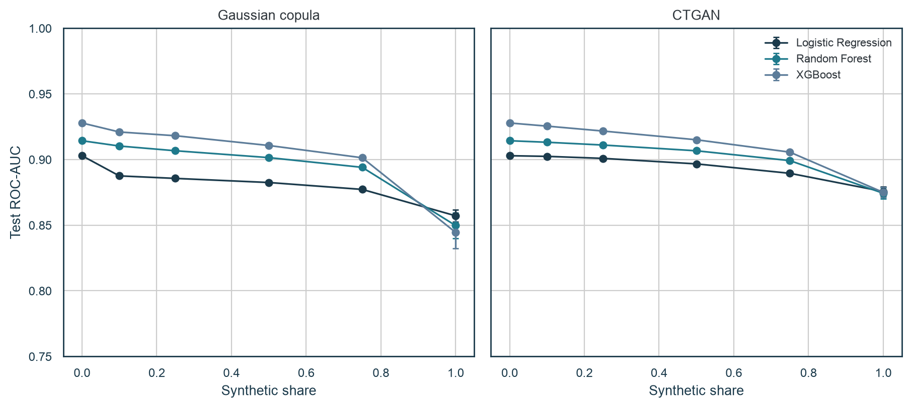

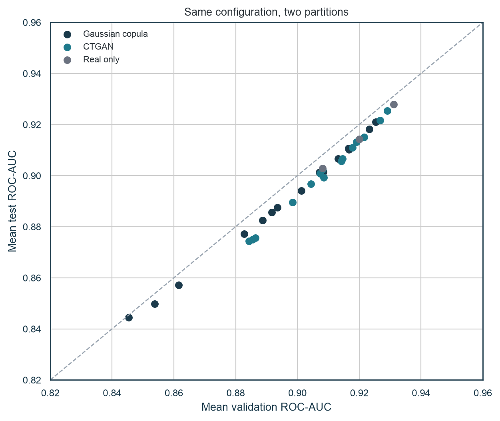

For main-experiment test ROC-AUC, 0 ROC-AUC intervals lay entirely above zero, 30 lay entirely below zero, and 0 covered zero.

Table 5. Paired test ROC-AUC differences in the main experiment.

| Generator | Share | Model | Mean difference [interval] | Reading |
| --- | --- | --- | --- | --- |
| CTGAN | 10% | Logistic Regression | -0.0005 [-0.0008, -0.0001] | lower |
| CTGAN | 10% | Random Forest | -0.0012 [-0.0015, -0.0009] | lower |
| CTGAN | 10% | XGBoost | -0.0024 [-0.0039, -0.0009] | lower |
| CTGAN | 25% | Logistic Regression | -0.0020 [-0.0024, -0.0016] | lower |
| CTGAN | 25% | Random Forest | -0.0033 [-0.0041, -0.0025] | lower |
| CTGAN | 25% | XGBoost | -0.0061 [-0.0068, -0.0055] | lower |
| CTGAN | 50% | Logistic Regression | -0.0062 [-0.0071, -0.0053] | lower |
| CTGAN | 50% | Random Forest | -0.0077 [-0.0080, -0.0073] | lower |
| CTGAN | 50% | XGBoost | -0.0128 [-0.0139, -0.0117] | lower |
| CTGAN | 75% | Logistic Regression | -0.0134 [-0.0145, -0.0123] | lower |
| CTGAN | 75% | Random Forest | -0.0151 [-0.0164, -0.0139] | lower |
| CTGAN | 75% | XGBoost | -0.0222 [-0.0237, -0.0207] | lower |
| CTGAN | 100% | Logistic Regression | -0.0273 [-0.0317, -0.0228] | lower |
| CTGAN | 100% | Random Forest | -0.0400 [-0.0450, -0.0350] | lower |
| CTGAN | 100% | XGBoost | -0.0528 [-0.0576, -0.0481] | lower |
| Gaussian copula | 10% | Logistic Regression | -0.0154 [-0.0156, -0.0152] | lower |
| Gaussian copula | 10% | Random Forest | -0.0040 [-0.0043, -0.0038] | lower |
| Gaussian copula | 10% | XGBoost | -0.0069 [-0.0074, -0.0063] | lower |
| Gaussian copula | 25% | Logistic Regression | -0.0173 [-0.0177, -0.0168] | lower |
| Gaussian copula | 25% | Random Forest | -0.0076 [-0.0081, -0.0071] | lower |
| Gaussian copula | 25% | XGBoost | -0.0097 [-0.0109, -0.0086] | lower |
| Gaussian copula | 50% | Logistic Regression | -0.0204 [-0.0210, -0.0198] | lower |
| Gaussian copula | 50% | Random Forest | -0.0129 [-0.0140, -0.0117] | lower |
| Gaussian copula | 50% | XGBoost | -0.0171 [-0.0187, -0.0156] | lower |
| Gaussian copula | 75% | Logistic Regression | -0.0257 [-0.0270, -0.0243] | lower |
| Gaussian copula | 75% | Random Forest | -0.0203 [-0.0220, -0.0185] | lower |
| Gaussian copula | 75% | XGBoost | -0.0265 [-0.0283, -0.0247] | lower |
| Gaussian copula | 100% | Logistic Regression | -0.0458 [-0.0512, -0.0403] | lower |
| Gaussian copula | 100% | Random Forest | -0.0646 [-0.0768, -0.0524] | lower |
| Gaussian copula | 100% | XGBoost | -0.0833 [-0.0984, -0.0683] | lower |

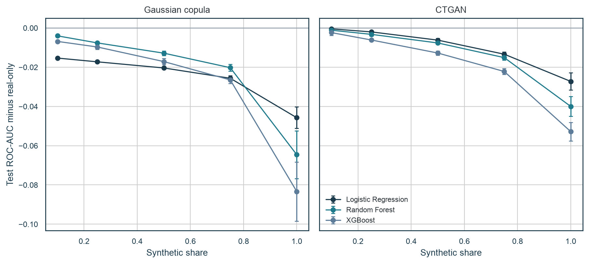

On the test partition, the paired secondary-metric readings are: f1 25 lower, 5 inconclusive, 0 higher; precision 13 lower, 12 inconclusive, 5 higher; recall 19 lower, 11 inconclusive, 0 higher; balanced_accuracy 22 lower, 8 inconclusive, 0 higher.

For test augmentation ROC-AUC, 0 ROC-AUC intervals lay entirely above zero, 16 lay entirely below zero, and 2 covered zero. 

Table 6. Paired test ROC-AUC differences for scarcity augmentation.

| Generator | Share | Model | Mean difference [interval] | Reading |
| --- | --- | --- | --- | --- |
| CTGAN | 10% | Logistic Regression | -0.0016 [-0.0031, -0.0002] | lower |
| CTGAN | 10% | Logistic Regression | -0.0002 [-0.0005, 0.0001] | inconclusive |
| CTGAN | 10% | Logistic Regression | -0.0003 [-0.0006, -0.0001] | lower |
| CTGAN | 10% | Random Forest | -0.0014 [-0.0021, -0.0006] | lower |
| CTGAN | 10% | Random Forest | -0.0006 [-0.0011, -0.0001] | lower |
| CTGAN | 10% | Random Forest | -0.0005 [-0.0012, 0.0002] | inconclusive |
| CTGAN | 10% | XGBoost | -0.0029 [-0.0040, -0.0018] | lower |
| CTGAN | 10% | XGBoost | -0.0011 [-0.0019, -0.0002] | lower |
| CTGAN | 10% | XGBoost | -0.0011 [-0.0020, -0.0002] | lower |
| Gaussian copula | 10% | Logistic Regression | -0.0153 [-0.0157, -0.0148] | lower |
| Gaussian copula | 10% | Logistic Regression | -0.0155 [-0.0160, -0.0149] | lower |
| Gaussian copula | 10% | Logistic Regression | -0.0156 [-0.0167, -0.0145] | lower |
| Gaussian copula | 10% | Random Forest | -0.0037 [-0.0045, -0.0029] | lower |
| Gaussian copula | 10% | Random Forest | -0.0038 [-0.0043, -0.0034] | lower |
| Gaussian copula | 10% | Random Forest | -0.0033 [-0.0035, -0.0032] | lower |
| Gaussian copula | 10% | XGBoost | -0.0049 [-0.0065, -0.0033] | lower |
| Gaussian copula | 10% | XGBoost | -0.0052 [-0.0066, -0.0038] | lower |
| Gaussian copula | 10% | XGBoost | -0.0055 [-0.0074, -0.0036] | lower |

For test replacement ROC-AUC, 0 ROC-AUC intervals lay entirely above zero, 17 lay entirely below zero, and 1 covered zero.

Table 7. Paired test ROC-AUC differences for fixed-size replacement.

| Generator | Share | Model | Mean difference [interval] | Reading |
| --- | --- | --- | --- | --- |
| CTGAN | 10% | Logistic Regression | -0.0020 [-0.0036, -0.0004] | lower |
| CTGAN | 10% | Logistic Regression | -0.0002 [-0.0006, 0.0002] | inconclusive |
| CTGAN | 10% | Logistic Regression | -0.0003 [-0.0006, -0.0001] | lower |
| CTGAN | 10% | Random Forest | -0.0019 [-0.0029, -0.0009] | lower |
| CTGAN | 10% | Random Forest | -0.0011 [-0.0017, -0.0005] | lower |
| CTGAN | 10% | Random Forest | -0.0009 [-0.0014, -0.0004] | lower |
| CTGAN | 10% | XGBoost | -0.0031 [-0.0041, -0.0021] | lower |
| CTGAN | 10% | XGBoost | -0.0019 [-0.0027, -0.0011] | lower |
| CTGAN | 10% | XGBoost | -0.0018 [-0.0029, -0.0007] | lower |
| Gaussian copula | 10% | Logistic Regression | -0.0154 [-0.0163, -0.0146] | lower |
| Gaussian copula | 10% | Logistic Regression | -0.0155 [-0.0163, -0.0148] | lower |
| Gaussian copula | 10% | Logistic Regression | -0.0156 [-0.0167, -0.0145] | lower |
| Gaussian copula | 10% | Random Forest | -0.0044 [-0.0059, -0.0030] | lower |
| Gaussian copula | 10% | Random Forest | -0.0042 [-0.0050, -0.0034] | lower |
| Gaussian copula | 10% | Random Forest | -0.0037 [-0.0042, -0.0032] | lower |
| Gaussian copula | 10% | XGBoost | -0.0044 [-0.0062, -0.0026] | lower |
| Gaussian copula | 10% | XGBoost | -0.0062 [-0.0081, -0.0044] | lower |
| Gaussian copula | 10% | XGBoost | -0.0055 [-0.0068, -0.0042] | lower |

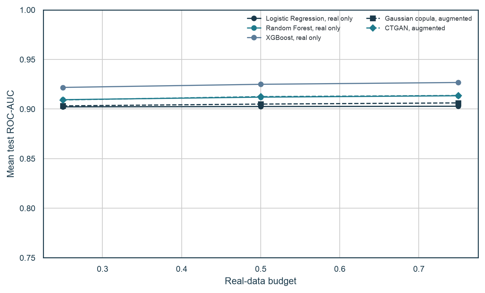

# 13. Validation compared with the test set

Table 8. Validation and test interval readings for ROC-AUC.

| Analysis | Validation lower | Validation inconclusive | Validation higher | Test lower | Test inconclusive | Test higher |
| --- | --- | --- | --- | --- | --- | --- |
| Main | 29 | 1 | 0 | 30 | 0 | 0 |
| Augmentation | 15 | 2 | 1 | 16 | 2 | 0 |
| Replacement | 16 | 2 | 0 | 17 | 1 | 0 |

The main ROC-AUC readings that differ are: CTGAN Logistic Regression at 10% (inconclusive on validation, lower on test). The validation augmentation contrast that was higher, with mean difference 0.000254, is not a test-set gain. Figure 12 plots the mean ROC-AUC of each main configuration on the two partitions. Points near the diagonal kept their rank. Points below the diagonal scored lower on the test partition than on the validation partition.

# 14. Discussion

## 14.1 Synthetic share

RQ1 asked whether some synthetic share would raise ROC-AUC. On the test set, 0 ROC-AUC intervals lay entirely above zero, 30 lay entirely below zero, and 0 covered zero. The pre-written hope of at least one mixed share above the real-only baseline is not supported. Performance falls as the synthetic share rises, and the 100 percent condition is the weakest. That condition replaces the real rows. It is not evidence about a small supplement by itself, but the 10, 25, 50, and 75 percent rows are already lower as well.

## 14.2 Generator choice

RQ2 asked which generator is less harmful under this protocol. For shares below 100 percent, the mean of the paired test ROC-AUC differences is -0.0077 for CTGAN and -0.0153 for the Gaussian copula. CTGAN loses less. Neither generator improves on real-only training. This is a description of one table and five seeds, not a ranking to be reused on another dataset.

## 14.3 Scarce real data

RQ3 asked whether synthetic rows help when real rows are fewer. On the test augmentation contrasts, 0 ROC-AUC intervals lay entirely above zero, 16 lay entirely below zero, and 2 covered zero. Adding synthetic rows increases the training size and still does not raise ROC-AUC above the budget baseline by a margin the interval can support. Fixed-size replacement, which holds the training size constant, does not show a gain either. The validation result that was higher by a fraction of a thousandth of an ROC-AUC point does not reappear as a test-set improvement.

## 14.4 Fidelity and utility

RQ4 asked whether fidelity and utility move together. They do not, in the direction a user would hope. The copula matches categories more closely and produces the weaker synthetic-only classifier. CTGAN is farther from the category frequencies and closer as a training set, while both remain below the real-only baseline. The positive Spearman correlation in Section 10 is a description of ten generator-seed points from one dataset. It is not a licence to choose a generator by total variation.

# 15. Limitations

Five seeds on one split give a t interval with four degrees of freedom. Repeating the seed does not create five independent datasets. A result on Adult does not establish the same pattern for another table, another class balance, or another generator.

CTGAN used 80 epochs rather than the library default of 300. The shorter budget was fixed from runtime, before utility results, and it can leave the generator under-trained. The Gaussian copula uses beta marginals because that is the library default, not because the features were shown to be beta.

The same validation partition was used for Phase 1 model selection and for the scarcity-ratio rule. The rule was written before the utility numbers were read, and the test set was not used to pick the 10 percent share, but the validation scores are not a fresh sample.

The pooled table has 26 cross-partition duplicate groups. Keeping them preserves the frozen split and can make validation scores slightly optimistic when an identical row sits in both training and validation.

Exact-match and near-duplicate rates depend on the encoding and the threshold. They are not a privacy audit.

Privacy, fairness, and a second dataset were outside the protocol. The duplicate checks are not the privacy evaluation discussed by Jordon et al. (2022), Pereira et al. (2024), or Adams et al. (2025).

A coding assistant drafted code and report prose. It did not choose hyperparameters, shares, or generators, and it did not use the held-out test for selection. Every number in this report is computed from the saved tables.

# 16. Conclusion

On the held-out test partition, 0 ROC-AUC intervals lay entirely above zero, 30 lay entirely below zero, and 0 covered zero. Synthetic augmentation did not improve ROC-AUC for these generators, classifiers, and shares. The same conclusion holds for the validation partition, with one inconclusive mixed-share interval there and none on the test set. Scarcity does not reverse the finding. Fidelity and utility disagree: the generator that is closer in category frequencies is the weaker training set.

These statements describe the frozen Adult experiment. They are not a general claim that synthetic data cannot help, and they are not a reason to retune epochs or shares on the test set.

# References

Achterberg, J., Haas, M., van Dijk, B., & Spruit, M. (2025). Fidelity-agnostic synthetic data generation improves utility while retaining privacy. *Patterns, 6*(10), 101287. https://doi.org/10.1016/j.patter.2025.101287

Adams, T., Birkenbihl, C., Otte, K., Ng, H. G., Rieling, J. A., Näher, A.-F., Sax, U., Prasser, F., Fröhlich, H., & Alzheimer’s Disease Neuroimaging Initiative. (2025). On the fidelity versus privacy and utility trade-off of synthetic patient data. *iScience, 28*(5), 112382. https://doi.org/10.1016/j.isci.2025.112382

Becker, B., & Kohavi, R. (1996). *Adult* [Dataset]. UCI Machine Learning Repository. https://doi.org/10.24432/C5XW20

Decruyenaere, A., Dehaene, H., Rabaey, P., Polet, C., Decruyenaere, J., Vansteelandt, S., & Demeester, T. (2024). The real deal behind the artificial appeal: Inferential utility of tabular synthetic data. *Proceedings of the Fortieth Conference on Uncertainty in Artificial Intelligence, 244*, 966–996. https://proceedings.mlr.press/v244/decruyenaere24a.html

Fonseca, J., & Bacao, F. (2023). Tabular and latent space synthetic data generation: A literature review. *Journal of Big Data, 10*, 115. https://doi.org/10.1186/s40537-023-00792-7

Hernandez, M., Epelde, G., Alberdi, A., Cilla, R., & Rankin, D. (2022). Synthetic data generation for tabular health records: A systematic review. *Neurocomputing, 493*, 28–45. https://doi.org/10.1016/j.neucom.2022.04.053

Jordon, J., Szpruch, L., Houssiau, F., Bottarelli, M., Cherubin, G., Maple, C., Cohen, S. N., & Weller, A. (2022). Synthetic data—what, why and how? arXiv. https://doi.org/10.48550/arXiv.2205.03257

Kurakova, A., & Homayouni, H. (2025). A comprehensive evaluation framework for synthetic medical tabular data generation. *Journal of Biomedical Informatics, 171*, 104939. https://doi.org/10.1016/j.jbi.2025.104939

Manousakas, D., & Aydöre, S. (2023). On the usefulness of synthetic tabular data generation. arXiv. https://doi.org/10.48550/arXiv.2306.15636

Pereira, M., Kshirsagar, M., Mukherjee, S., Dodhia, R., Lavista Ferres, J., & de Sousa, R. (2024). Assessment of differentially private synthetic data for utility and fairness in end-to-end machine learning pipelines for tabular data. *PLOS ONE, 19*(2), e0297271. https://doi.org/10.1371/journal.pone.0297271

Xu, L., Skoularidou, M., Cuesta-Infante, A., & Veeramachaneni, K. (2019). Modeling tabular data using conditional GAN. *Advances in Neural Information Processing Systems, 32*. https://doi.org/10.5555/3454287.3454946

# Appendix A. Reproduction

Validation metrics: `results/tables/study/run_metrics.csv`. Test metrics: `results/final_evaluation/test_run_metrics.csv`. Paired test differences: `results/final_evaluation/paired_differences.csv`. The freeze hash recorded with the evaluation is `e06887586eb1e02a416e3db63bb941f9ec38b30e14dad0db444847fd177d8180`. The source-tree fingerprint recorded at evaluation time is `0b9a8cd5da8d38fca17c7b2ebeb33782cb8e9d6541623bcc5db62152aa47b713`. The project directory was not a Git repository, so there is no commit hash.

The validation command is `uv run python scripts/run_validation_study.py`. The held-out command is `uv run python scripts/run_final_test.py --final-test`. That command was not run again for this report. The original freeze file still records `test_metrics_computed: false`. The separate file `results/frozen/post_evaluation_status.json` records that the previously authorized test evaluation was later completed and checked. Tests are `uv run pytest`. The integration test fits a toy generator and is excluded from the fast suite.

CTGAN epochs remain 80. Seeds remain 42, 123, 2024, 3407, and 777. The scarcity share remains 10 percent.